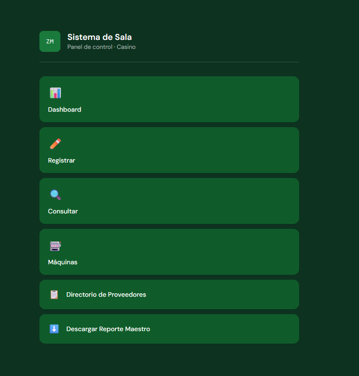

# Sistema de pagos en sala

Aplicación web para registrar los pagos que se hacen en la sala de un casino, sincronizarlos con oficina y generar reportes.



## Qué hace

- **Sala:** los técnicos registran cada pago (máquina, monto, técnico, gerente) y pueden consultar, editar y cerrar el día.
- **Sincronización con oficina:** cada pago se envía a oficina; si el envío falla, queda en una cola de pendientes y se reintenta.
- **Oficina:** catálogos de máquinas y proveedores, dashboard, histórico y exportación de reportes en PDF y Excel.

## Tecnologías

- PHP y MySQL (XAMPP)
- FPDF para los reportes en PDF
- HTML y CSS

## Estructura

```
sala/              registro de pagos en piso
oficina/           catálogos, reportes y recepción de pagos
schema_sala.sql    esquema de la base de datos de sala (pagos, cola de envíos, técnicos, gerentes)
docs/              capturas
```

## Cómo correrlo

1. Instala XAMPP y copia el proyecto en `htdocs/`.
2. Crea la base de datos con `schema_sala.sql`.
3. Crea tus archivos de conexión `sala/db.php` y `oficina/conexion.php` (no están en el repositorio a propósito, porque contienen credenciales).

## Estado

Se usó en operación real hasta que cambió el proceso de registro de pagos. Los datos reales y las credenciales nunca se subieron al repositorio.
